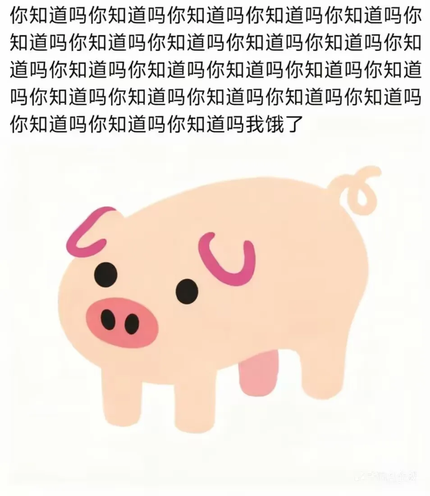
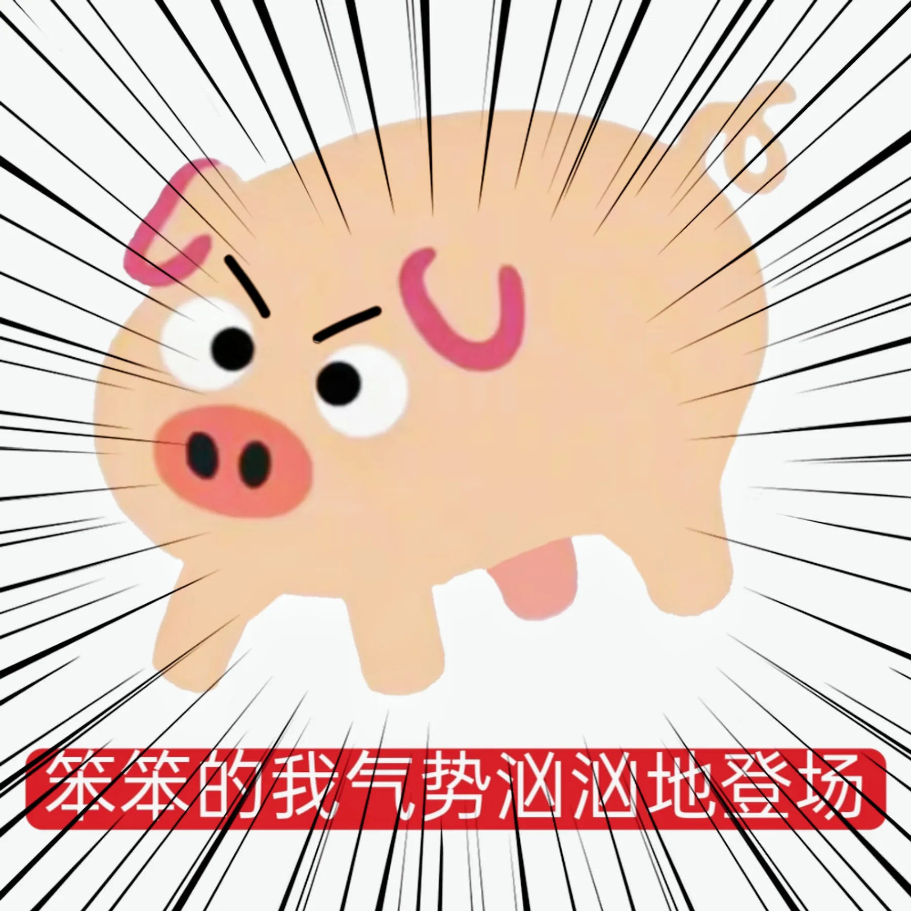

# 图内文字与非本地化标记

八张现有PigHub原图逐一人工查看。标题/信件在主CSV内；下面是位图自身文字，不能通过翻译表修改。不修改原图、水印或来源声明。细字无法可靠辨认时明确保留未知。

锁定表情的 `?` 属于绘制标记，不是缺失译文；操作系统/Godot提供的原生菜单不是本地化CSV内容。其他生成角色、家具和UI图标不是本轮可编辑文案表；若发现位图里的装饰字形需另外看图确认。

## postcard_wake

- 图库原标题：你醒啦
- 可辨图内文字：你醒啦，你刚刚一直在说 / 什么要考试、要找工作什么的， / 是不是吃错饲料了， / 我们只是小猪猪呀
- 备注：主文字人工看图转录；换行是图像排版，不是本地化变量。

## postcard_carrot

- 图库原标题：萝卜猪
- 可辨图内文字：萝卜猪
- 备注：图内标题。

## postcard_flat

- 图库原标题：扁猪
- 可辨图内文字：无
- 备注：未发现可辨文字，只有猪形象。

## postcard_huddle

- 图库原标题：欢乐多猪
- 可辨图内文字：欢乐多猪
- 备注：图内标题。

## postcard_park

- 图库原标题：乱停猪
- 可辨图内文字：乱停猪 / 罚单 / Z / z
- 备注：罚单内部英文与表格细字不能可靠辨读，未猜写；原图随包附上供复核。

## postcard_fact

- 图库原标题：你知道吗
- 可辨图内文字：你知道吗（多次重复）……我饿了
- 备注：记录重复句的结构而非猜测次数；右下浅色水印不能可靠辨读，不删改水印。

## postcard_bold

- 图库原标题：笨笨的猪气势汹汹地登场！
- 可辨图内文字：笨笨的我气势汹汹地登场
- 备注：人工看图转录。来源登记标题用“猪”，实际图中文字用“我”，两者分开保留。

## postcard_belly

- 图库原标题：肥猪
- 可辨图内文字：肥猪
- 备注：图内标题。

